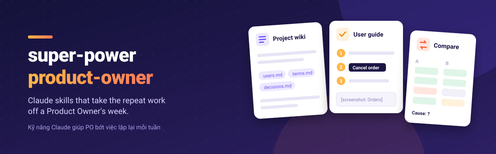

<p align="center"></p>

# super-power-product-owner

Tiếng Việt: [README.vi.md](./README.vi.md)

Claude skills that take the repeat work off a Product Owner's week. Each project gets a small
wiki that grows while you work. The skills read it, so their output uses your product's words.

Works for any company and any product. Version 0.2.0 has the base, the two first jobs, and a feedback skill.

## Install

**Cowork (Claude desktop app):** open the plugin settings, add the marketplace
`lethuan127/super-power-product-owner`, then install `super-power-product-owner`.

**Claude Code:**

```
/plugin marketplace add lethuan127/super-power-product-owner
/plugin install super-power-product-owner --marketplace lethuan127/super-power-product-owner
```

## Start

Open a folder for your project, then type one line:

```
set up project Order System
```

or `thiết lập dự án Order System`. Then ask for real work at once.

## Skills

| Skill | Say | What you get |
|---|---|---|
| `setup-project` | "set up project X" | `CLAUDE.md`, `index.md`, `log.md`; ready in one minute |
| `add-to-project` | "add this to the project" + a file or a link | the wiki pages it changed |
| `ask-project` | "what did we decide about X?" | an answer with a link behind each claim |
| `write-guide` | "write a user guide for X" / "update the guides after this change" | a step-by-step guide, or the list of broken steps |
| `compare-lists` | "reconcile file A with file B" | four tables: matched, only in A, only in B, amount differs |
| `send-feedback` | "report this" / "suggest a feature" | a GitHub issue for the maintainer, with private data removed, sent after your "yes" |
| `core` | (not called directly) | the shared rules every skill follows |

## Safety

- Claude never sends a message or a mail.
- Claude edits an existing page, creates a ticket, or saves in a web app only after your "yes".
- Claude never asks for a password or a token. You log in to each app yourself.
- `compare-lists` never changes your input files.
- `send-feedback` files a public GitHub issue only after your "yes", and removes company,
  customer and personal data first.

## Develop

The design docs are in [docs/](./docs/). Read them in this order:

| File | What it answers |
|---|---|
| [01-vision.md](./docs/01-vision.md) | Who it is for, the problem, the goals, and what it will not do |
| [02-project-wiki.md](./docs/02-project-wiki.md) | How a project is stored: sources, wiki pages, schema |
| [03-skills.md](./docs/03-skills.md) | Every planned skill: input, output, and how to tell it is done |
| [04-architecture.md](./docs/04-architecture.md) | How the plugin ships, its files, languages and safety |
| [05-roadmap.md](./docs/05-roadmap.md) | Phases, questions for the first user, and the next step |
| [06-onboarding.md](./docs/06-onboarding.md) | Install, set up a project in one line, and start work |
| [07-open-source.md](./docs/07-open-source.md) | The open-source checklist and this repo's status |

Each claim about a PO's work in the docs is marked **Told** (a PO said so), **Assumed** (a common
PO job), or **Tested** (someone ran the skill on real work).

Checks and rules for a change: [CONTRIBUTING.md](./CONTRIBUTING.md). Security reports:
[SECURITY.md](./SECURITY.md).

## Versions

- **0.2.5:** `send-feedback` handles a sandbox that routes GitHub through `add_repo`, and falls back to
  the web fetch tool. Its description now says to check feedback status here first.
- **0.2.4:** `send-feedback` reads GitHub through the public API when `gh` and a connector are missing, so "what happened to my feedback?" works in Cowork.
- **0.2.3:** `send-feedback` drafts an issue the maintainer can act on without asking back: an
  impact line, steps to reproduce, an excerpt of the wrong output, and "Done when" checks. It
  comments on an open issue about the same problem instead of filing a new one. It also tells
  the user what happened to feedback they sent.
- **0.2.2:** `write-guide` never leaves "Common mistakes" empty: it adds 2 to 4 likely
  mistakes, each marked "(to confirm)" (#1). `send-feedback` gives a user with no GitHub
  account a saved file next to the link.
- **0.2.1:** `setup-project` gives example lines the user can send as they are, and says
  nothing about git. In a temporary workspace with a Project attached, the wiki lives in the
  Project's files. `add-to-project` saves a redacted copy of each source there, so every source
  the wiki cites survives the session.
- **0.2.0:** `send-feedback` turns the user's feedback into a GitHub issue, after a "yes" and
  with private data removed. Output follows the project language; `core/locales/vi.md` sets the
  Vietnamese headings, number and date formats. `setup-project` tells the user the language and
  how to change it. Open-source files: LICENSE, CONTRIBUTING, SECURITY, issue forms, CI.
- **0.1.0:** first version. Project wiki (setup, add, ask), `write-guide`, `compare-lists`, and
  the `core` rules.
