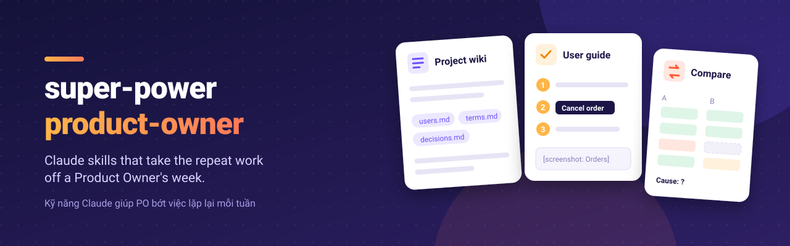

<p align="center"></p>

# super-power-product-owner (tiếng Việt)

Bộ kỹ năng cho Claude, giúp Product Owner (PO) bớt việc lặp lại mỗi tuần.

Mỗi dự án có một "wiki dự án". Wiki là vài trang ghi chú do Claude tự viết và cập nhật trong lúc
bạn làm việc. Claude đọc wiki này, nên kết quả dùng đúng từ ngữ của sản phẩm bạn.

Plugin dùng được cho mọi công ty và mọi sản phẩm. Bản 0.2.0 có phần nền, 2 việc đầu tiên, và kỹ năng gửi góp ý.

## Cài đặt (làm một lần, khoảng 5 phút)

**Trên Cowork (app Claude trên máy tính):**

1. Mở phần cài đặt plugin.
2. Thêm marketplace: `lethuan127/super-power-product-owner`.
3. Cài plugin `super-power-product-owner`.

## Bắt đầu

1. Chọn một thư mục cho dự án.
2. Gõ một câu:

   ```
   thiết lập dự án Quản lý đơn hàng
   ```

3. Làm việc luôn. Không cần điền gì thêm.

Claude viết mọi tài liệu bằng ngôn ngữ bạn dùng khi thiết lập, kể cả spec cho dev. Muốn đổi,
gõ "đổi ngôn ngữ sang tiếng Anh".

Khi Claude cần thông tin, Claude sẽ hỏi đúng lúc đó. Bạn trả lời một lần, Claude ghi nhớ cho các
lần sau.

## Các câu chat mẫu

| Bạn muốn | Gõ |
|---|---|
| Lưu tài liệu vào dự án | "lưu file này vào dự án" (kèm file hoặc link) |
| Hỏi lại điều đã chốt | "dự án đã chốt gì về hoàn tiền?" |
| Viết hướng dẫn sử dụng | "viết hướng dẫn sử dụng cho tính năng hủy đơn" |
| Cập nhật hướng dẫn sau khi có thay đổi | "cập nhật hướng dẫn sau bản release này" (kèm danh sách thay đổi) |
| Đối soát với kế toán | "đối soát file đơn hàng tháng 10 với file kế toán" |

## Đối soát chạy thế nào

1. Claude cho bạn xem tên cột và vài dòng đầu của mỗi file.
2. Claude đề xuất cột để nối hai file (ví dụ số hóa đơn) và cột số tiền.
3. **Bạn xác nhận.** Claude không tự chạy khi chưa có xác nhận.
4. Một script so từng dòng và cộng tổng. Claude không tự cộng bằng mắt.
5. Bạn nhận 4 bảng: khớp, chỉ có bên A, chỉ có bên B, lệch số tiền. Kèm một file `.xlsx`.

Claude chỉ ghi nguyên nhân lệch khi dữ liệu cho thấy rõ. Nếu không, Claude ghi "Nguyên nhân: ?". Bạn là
người hiểu nghiệp vụ.

## An toàn

- Claude không bao giờ gửi tin nhắn hay email.
- Claude chỉ sửa trang có sẵn, tạo ticket, hay bấm lưu trên web sau khi bạn nói "yes".
- Claude không bao giờ hỏi mật khẩu. Bạn tự đăng nhập vào từng app.
- Claude không sửa, không xóa file gốc của bạn.
- Wiki ghi vai trò ("trưởng phòng kế toán"), không ghi tên, số điện thoại hay email.

## Gặp vấn đề hoặc muốn góp ý

Gõ "báo lỗi plugin" hoặc "góp ý plugin: ...". Claude viết sẵn một issue trên GitHub, xóa hết tên
công ty, tên người và số liệu thật, rồi cho bạn xem. Bạn nói "yes" thì Claude mới gửi.

Trang GitHub này công khai. Hãy đọc kỹ bản nháp trước khi nói "yes".
